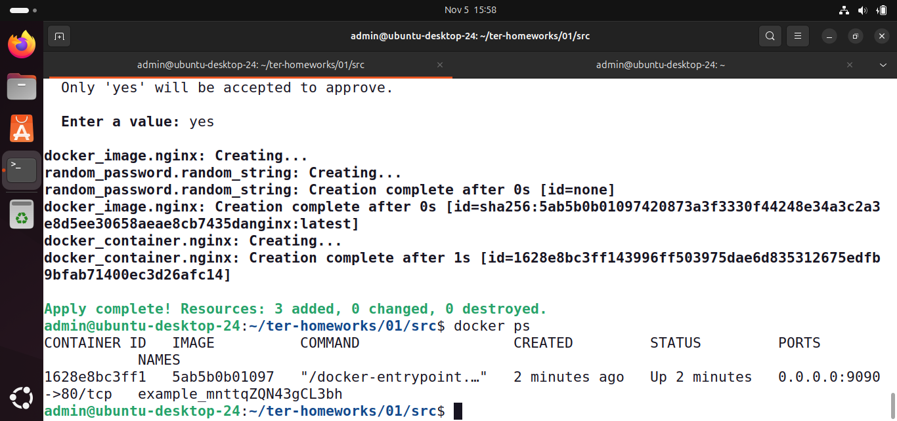
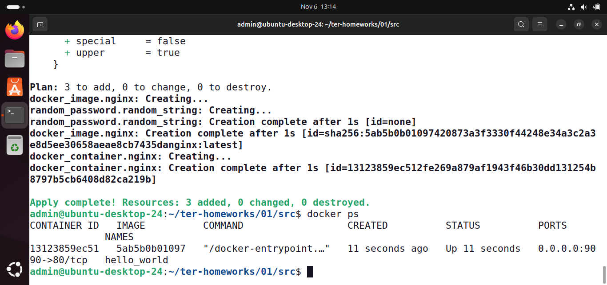

# Домашнее задание к занятию "Введение в Terraform" - Гусев Алексей

### Задание 1

1. Перейдите в каталог [**src**](https://github.com/netology-code/ter-homeworks/tree/main/01/src). Скачайте все необходимые зависимости, использованные в проекте. 
2. Изучите файл **.gitignore**. В каком terraform-файле, согласно этому .gitignore, допустимо сохранить личную, секретную информацию?(логины,пароли,ключи,токены итд)

<em>

**Файлы для хранения секретной информации:**
 - `*.tfstate`
 - `*.tfstate.*`
 - `personal.auto.tfvars`
</em>

3. Выполните код проекта. Найдите  в state-файле секретное содержимое созданного ресурса **random_password**, пришлите в качестве ответа конкретный ключ и его значение.

<em>

**Ключ и его значение:**
 - `"result": "mnttqZQN43gCL3bh"`
</em>

4. Раскомментируйте блок кода, примерно расположенный на строчках 29–42 файла **main.tf**.
Выполните команду ```terraform validate```. Объясните, в чём заключаются намеренно допущенные ошибки. Исправьте их.

<em>

**Допущенные ошибки:**
```markdown
│ Error: Missing name for resource
│ 
│   on main.tf line 23, in resource "docker_image":
│   23: resource "docker_image" {
│ 
│ All resource blocks must have 2 labels (type, name).
```
Означает, что в файле main.tf ресурсу "docker_image" определен только тип, но не определено имя ресурса в проекте.

```markdown
│ Error: Invalid resource name
│ 
│   on main.tf line 28, in resource "docker_container" "1nginx":
│   28: resource "docker_container" "1nginx" {
│ 
│ A name must start with a letter or underscore and may contain only letters, digits,
│ underscores, and dashes.
```
Означает, что в файле main.tf имя ресурса должно начинаться с буквы или знака подчеркивания и может содержать только буквы, цифры, знаки подчеркивания и дефисы.

</em>

6. Выполните код. В качестве ответа приложите: исправленный фрагмент кода и вывод команды ```docker ps```.

[**ссылка на main.tf**](https://github.com/netolearning777/git-terraform-hw/blob/main/01/main.tf)




7. Замените имя docker-контейнера в блоке кода на ```hello_world```. Не перепутайте имя контейнера и имя образа. Мы всё ещё продолжаем использовать name = "nginx:latest". Выполните команду ```terraform apply -auto-approve```.
Объясните своими словами, в чём может быть опасность применения ключа  ```-auto-approve```. Догадайтесь или нагуглите зачем может пригодиться данный ключ? В качестве ответа дополнительно приложите вывод команды ```docker ps```.

<em>
Использование ```terraform apply -auto-approve``` отключает этап интерактивного подтверждения. Опасности использования:

- случайное удаление инфраструктуры;
- пропуск ошибок самого Terraform. Terraform может составить логичный план, но разрушит рабочую инфраструктуру.

Использование ```terraform apply -auto-approve``` оправдано только при автоматических CI/CD конвейерах.



</em>

8. Уничтожьте созданные ресурсы с помощью **terraform**. Убедитесь, что все ресурсы удалены. Приложите содержимое файла **terraform.tfstate**. 

[**ссылка на terraform.tfstate**](https://github.com/netolearning777/git-terraform-hw/blob/main/01/terraform.tfstate)


9. Объясните, почему при этом не был удалён docker-образ **nginx:latest**. Ответ **ОБЯЗАТЕЛЬНО НАЙДИТЕ В ПРЕДОСТАВЛЕННОМ КОДЕ**, а затем **ОБЯЗАТЕЛЬНО ПОДКРЕПИТЕ** строчкой из документации [**terraform провайдера docker**](https://library.tf/providers/kreuzwerker/docker/latest).  (ищите в классификаторе resource docker_image )
<em>

```hcl
resource "docker_image" "nginx" {
  name         = "nginx:latest"
  keep_locally = true
}
```
**`keep_locally = true`** — параметр указывает Terraform не удалять Docker-образ с хост-машины при уничтожении инфраструктуры. Образ останется в локальном кэше Docker.

Optional
- **`keep_locally (Boolean)`** If true, then the Docker image won't be deleted on destroy operation. If this is false, it will delete the image from the docker local storage on destroy operation.

</em>

------
